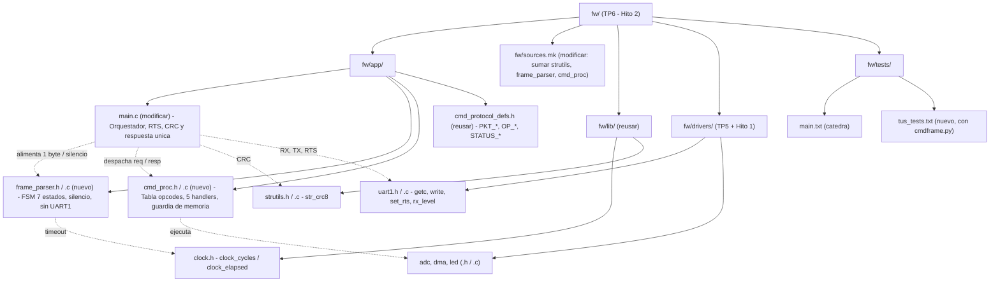

# TP6 — Decisiones de Diseño y Bitácora (Hito 2)

> Documento vivo con las decisiones de arquitectura, patrones elegidos, alternativas descartadas y pasos de implementación del Procesador de Comandos (`tp6.md`). Pensado también como base para la justificación de diseño de la entrega (§5 y §6).

---

## Estado actual

- **Paso 0 (TP5):** `make test_drivers` y `make test_uart_serial` en **PASS**.
- **Hito 1 (Control de flujo RTS):** implementado en `fw/drivers/src/uart1.c` y `fw/tests/test_flow_control.c` — `make test_flow_control` en **PASS**.
- **Hito 2 (Procesador de comandos):** implementado en `fw/app/frame_parser.{h,c}`, `fw/app/cmd_proc.{h,c}`, `fw/app/main.c` y `fw/sources.mk` — `make test_main` en **PASS**.

---

## Decisiones de arquitectura acordadas

### 1. FSM acotada a la recepción de tramas (no FSM global)
- **Decisión:** usar una **Máquina de Estados Finitos (FSM)** únicamente para sincronizar el flujo de bytes y armar/detectar tramas (`HEADER`, `LENGTH`, cuerpo, `FOOTER`, timeout por silencio y corte por nuevo `HEADER`). Una vez que llega una trama completa (o se detecta un error de framing), el flujo **bajar RTS → validar → despachar → responder → subir RTS** es secuencial.
- **Problema que resuelve:** recibir un *stream* continuo con ruido, longitudes variables, tramas truncadas y tramas interrumpidas sin bloquear el lazo principal ni enredarse en banderas booleanas sueltas.
- **Alternativa descartada:**
  - *FSM global* incluyendo validación, ejecución y respuesta: esos pasos son estrictamente lineales y ocurren con RTS abajo, por lo que modelarlos como estados solo agrega complejidad y código innecesario.
  - *Lectura secuencial bloqueante*: se traba ante tramas incompletas y no puede detectar un `0xA5 0x5A` inesperado en medio de una trama.
- **Costo / trade-off:** requiere mantener un pequeño contexto de estado del parser y cuidar el reseteo de variables en cada transición.

### 2. Respuesta única + patrón Command con tabla de callbacks
- **Decisión:**
  - **Respuestas y errores unificados en una sola función:** arma y transmite cualquier paquete de respuesta (`HEADER`, `LENGTH`, `OPCODE | 0x80`, `STATUS`, datos opcionales, `CRC` con `str_crc8`, `FOOTER`). Un error es simplemente esa misma función con `STATUS != OK` y 0 bytes de datos.
  - **Despacho de comandos con patrón Command + tabla de callbacks:** cada `OPCODE` se mapea a una función manejadora con firma uniforme (`req → resp`).
- **Problema que resuelve:** evita duplicar el armado de tramas de error/éxito y desacopla por completo el protocolo (framing/CRC) de la lógica de cada periférico. Agregar un comando nuevo solo exige agregar una función y una entrada en la tabla, sin tocar el parser ni el empaquetador.
- **Alternativa descartada:**
  - *Strategy para unificar errores*: sobreingeniería; el formato de respuesta ya es idéntico para éxito y error.
  - *`switch (opcode)` monolítico dentro del parser*: mezcla capas y obliga a tocar el parser cada vez que se agrega un comando.
- **Costo / trade-off:** una indirección por puntero a función y una tabla pequeña en `.rodata` (despreciable en tiempo y memoria).

### 3. Modularización en 3 piezas (*divide and conquer*)
- **Decisión:** dividir el Hito 2 en tres responsabilidades claras:
  1. **Parser de tramas (FSM):** consume 1 byte por llamada, controla silencio con `clock.h`, detecta `0xA5 0x5A` a mitad de trama y notifica trama lista o error de framing. No conoce comandos ni periféricos.
  2. **Comandos + guardia de memoria:** 5 handlers chicos (`ADC`, `DMA`, `MEM_READ`, `MEM_WRITE`, `LED`) y **un único helper de validación de direcciones** reutilizado por `MEM_READ`, `MEM_WRITE` y `DMA` (rangos desde `config.h`, sin cruce de regiones, alineación a 4 bytes y bloqueo explícito de escritura a `REG_MCU_RESET`).
  3. **Orquestador (`fw/app/main.c`):** superloop que gestiona RTS, alimenta al parser, invoca al despachador y llama a la función única de respuesta.
- **Problema que resuelve:** permite desarrollar, razonar y probar cada capa de forma aislada sin sobre-fragmentar en demasiados archivos.

---

## Diseño del Parser de Tramas (FSM)

### Contrato Parser ↔ Orquestador
- **Entradas (2 operaciones):**
  1. *Alimentar 1 byte* (invocada por el orquestador cada vez que `uart1_getc` entrega un byte).
  2. *Chequear silencio* (invocada cuando no llegó ningún byte, usando `clock.h`).
- **Salidas (3 resultados posibles):**
  - **`IN_PROGRESS`:** todavía faltan bytes (o era ruido / se descartó por silencio).
  - **`FRAME_READY`:** trama cerrada (llegaron los 2 bytes de `FOOTER`) → entrega `opcode`, puntero al cuerpo (`OPCODE + PAYLOAD`), `body_len`, `crc` recibido y un flag de si el `FOOTER` coincidió. **No** corre `str_crc8()` adentro del parser para poder frenar al host con `RTS` antes de calcularlo.
  - **`FRAME_ERROR`:** error de framing temprano (`LENGTH` fuera de `[2, 1032]` o trama interrumpida por otro `0xA5 0x5A`) → entrega `ERROR_LENGTH` y el `opcode` a reportar (`0` si se cortó antes de recibirlo).

### Estados de la FSM (7 estados)
Regla aplicada: **solo es estado aquello donde hay que esperar el próximo byte** (`VERIFY`, `OK` y `CORRUPTED` son transiciones/valores de retorno, no estados).

1. **`WAIT_HDR0`:** espera `0xA5`; cualquier otro byte es ruido y se ignora sin responder.
2. **`WAIT_HDR1`:** espera `0x5A`; si llega otro `0xA5` permanece en `WAIT_HDR1`; cualquier otro byte vuelve a `WAIT_HDR0`.
3. **`WAIT_LEN_LO`:** recibe byte bajo de `LENGTH`.
4. **`WAIT_LEN_HI`:** recibe byte alto de `LENGTH` y valida rango `[2, 1032]`. Si está fuera de rango: `FRAME_ERROR` (`ERROR_LENGTH`, `opcode = 0`) y vuelve a `WAIT_HDR0`.
5. **`RECV_BODY`:** acumula `LENGTH` bytes (`OPCODE + PAYLOAD + CRC`) en el buffer interno.
6. **`WAIT_FTR0`:** espera `0xC3`.
7. **`WAIT_FTR1`:** espera `0x3C`, cierra la trama y vuelve a `WAIT_HDR0` devolviendo el resultado.

### Reglas transversales (para todo estado `!= WAIT_HDR0`)
- **Silencio:** si `clock_elapsed(last_rx) > SILENCE_CLOCKS`, resetea a `WAIT_HDR0` y devuelve `IN_PROGRESS` (descarta sin responder).
- **Nuevo `HEADER` (`0xA5 0x5A`) en medio de una trama:** devuelve `FRAME_ERROR` (`ERROR_LENGTH` con el `opcode` acumulado o `0` si aún estaba en `LENGTH`) y salta directo a `WAIT_LEN_LO`.

---

### Estrategia de Control de Flujo (`RTS`) en Hito 2
- **Durante la recepción normal:** mantener el chequeo de nivel del FIFO RX con histéresis (igual que en Hito 1) como red de seguridad.
- **Al cerrar o interrumpir una trama (`FRAME_READY` o `FRAME_ERROR`):**
  1. El orquestador **baja `RTS` primero** (frena al host antes de cualquier tramo largo sin leer la UART).
  2. Si fue `FRAME_READY`, corre `str_crc8()` con el host ya frenado (evita overrun por el tiempo del CRC en tramas de hasta 1031 bytes). Si fallan `CRC` y `FOOTER` juntos, prioriza `ERROR_CRC`.
  3. Despacha el comando (si todo estuvo OK) y transmite la respuesta completa por UART1 (también en `ERROR_LENGTH` por trama interrumpida).
  4. Al terminar de responder, **vuelve a subir `RTS`** y retoma la lectura del FIFO (absorbiendo sin pérdida los hasta 3 bytes de *skid* de la trama siguiente).
- **Ventaja adicional:** el parser queda 100% desacoplado de `UART1` (no llama a `uart1_set_rts()`).

---

## Casos borde a tener presentes

- **`0xA5 0xA5 0x5A`:** esperando el segundo byte del header (`0x5A`), si llega otro `0xA5` hay que permanecer esperando `0x5A`, no volver al estado inicial.
- **Prioridad de errores de trama:** si fallan `CRC` y `FOOTER` a la vez, se responde `ERROR_CRC`.
- **Trama interrumpida por otro `0xA5 0x5A`:** se responde `ERROR_LENGTH` con el `OPCODE` de la trama cortada (o `0`, es decir `0x80`, si todavía no había llegado el `OPCODE`) y se continúa directamente leyendo el `LENGTH` de la trama nueva.
- **Silencio:** el timeout (`clock_elapsed`, entre 2.000 y 150.000 clocks, ej. 40.000) solo se evalúa con una trama a medias, y se descarta **sin responder**.
- **Alineación en RV32I:** reconstruir `uint16_t` y `uint32_t` little-endian byte a byte desde el payload (no castear punteros) para evitar `TRAP` por acceso desalineado.
- **Validación de memoria sin overflow:** chequear que `addr + size` no desborde 32 bits ni cruce entre regiones (`INST`, `DATA`, `REG_FILE`).

---

## Esqueleto de archivos del TP6 (Hito 2)

Estructura mínima (sin archivos de más), alineada 1-a-1 con las 3 piezas acordadas:

### Módulos nuevos a crear en `fw/app/`
- **`fw/app/frame_parser.h` / `fw/app/frame_parser.c`** — *Pieza 1: Parser de tramas (FSM)*
  - Tipos: los 7 estados de la FSM, contexto del parser (estado, `length`, buffer del cuerpo de 1032 B, índice, flag de `0xA5` previo, `last_rx`) y estructura de resultado (`IN_PROGRESS`, `FRAME_READY`, `FRAME_ERROR`).
  - Funciones públicas: inicializar parser, alimentar 1 byte, chequear timeout por silencio (`clock.h`).
  - Límite estricto: **no** toca `UART1`, **no** corre `str_crc8()`, **no** conoce comandos.
- **`fw/app/cmd_proc.h` / `fw/app/cmd_proc.c`** — *Pieza 2: Comandos + guardia de memoria*
  - Tipos: estructuras de request (`opcode`, `payload`, `payload_len`) y response (`status`, buffer de salida, `data_len`), firma de handler y tabla estática `opcode → handler`.
  - Helpers internos: lectura/escritura little-endian byte a byte (para evitar `TRAP` en RV32I) y **validador único de memoria** (rangos de `config.h`, sin cruce de regiones ni overflow, alineación a 4 B y bloqueo de escritura sobre `REG_MCU_RESET`).
  - Handlers internos: `ADC`, `DMA`, `MEM_READ`, `MEM_WRITE`, `LED` (usando los drivers del TP5).
  - Función pública: despachar un request y llenar la response.
  - Límite estricto: **no** sabe de `HEADER`, `FOOTER`, `CRC` ni `UART1`.

### Archivos existentes a modificar
- **`fw/app/main.c`** — *Pieza 3: Orquestador + empaquetador de respuestas*
  - Inicializa `UART1`, `RTS` y el parser.
  - Función única de envío de respuesta (arma `HEADER`, `LENGTH`, `OPCODE | 0x80`, `STATUS`, datos opcionales, `str_crc8()`, `FOOTER`).
  - Superloop: chequeo de nivel FIFO (`RTS` con histéresis), lectura de 1 byte o chequeo de silencio, y al recibir `FRAME_READY` o `FRAME_ERROR`: baja `RTS` → verifica `CRC`/`FOOTER` (prioridad `ERROR_CRC`) → despacha → responde → sube `RTS`.
- **`fw/sources.mk`** — *Listado de compilación*
  - Agregar `lib/src/strutils.c` (para `str_crc8`), `app/frame_parser.c` y `app/cmd_proc.c`.

### Archivos ya dados que se reutilizan (sin modificar)
- `fw/app/cmd_protocol_defs.h` — constantes `PKT_*`, `OP_*`, `LED_OP_*`, `STATUS_*`.
- `fw/lib/inc/clock.h` — `clock_cycles()`, `clock_elapsed()`.
- `fw/lib/inc/strutils.h` y `fw/lib/src/strutils.c` — `str_crc8()`.
- `fw/drivers/inc/{uart1,adc,dma,led}.h` y sus `.c` — drivers del TP5 + control de flujo del Hito 1.
- `fw/config.h` (vía `includes.h`) — `ADDR_START_*`, `ADDR_SIZE_*`, `REG_MCU_RESET`.

### Tests propios a crear
- **`fw/tests/<tus_tests>.txt`** — patrones generados con `fw/tools/cmdframe.py` para probar incrementalmente (ej. `LED`, errores de framing, validación de direcciones y `REG_MCU_RESET`, tramas pegadas).

---

## Plan incremental (*divide and conquer*)

1. **Parser mínimo (camino feliz) + respuesta única + `LED`:** probar de punta a punta con un patrón propio generado con `cmdframe.py`.
2. **Robustez del parser:** `CRC` malo, `FOOTER` malo, `LENGTH` fuera de `[2, 1032]`, ruido, timeout de silencio y trama interrumpida por nuevo `HEADER`.
3. **Guardia de memoria + `MEM_READ` / `MEM_WRITE`.**
4. **`ADC` y `DMA`** integrando los drivers del TP5.
5. **Control de flujo (RTS) en tramas largas pegadas** y validación completa con `make test_main`.
6. **Tests propios en `fw/tests/`** cubriendo errores, resincronización y límites de §3.7.

---

## Qué falta para cerrar la entrega (§5 y §6)

- [ ] **Tests propios en `fw/tests/`** (generados con `fw/tools/cmdframe.py` y corridos con `make test_main UART1_SCRIPT=fw/tests/<archivo>.txt`):
  - **Framing y resincronización:** CRC malo, FOOTER malo, CRC + FOOTER malos a la vez (verificar prioridad `ERROR_CRC`), `LENGTH` fuera de `[2, 1032]`, ruido + `0xA5 0xA5 0x5A`, trama interrumpida por otro `0xA5 0x5A` (antes y después de `OPCODE`) y descarte por silencio sin respuesta.
  - **Límites de memoria (§3.7):** dirección fuera de `0x0000_0000`–`0x0005_FFFF`, cruce de región (`INST`/`DATA`/`REG_FILE`), dirección desalineada, overflow en `addr + size`, escritura sobre `REG_MCU_RESET` (`0x0004_0014`) tanto por `MEM_WRITE` como por `DMA`.
  - **Errores de parámetros:** `LED` con `op` inválido o largo incorrecto, `ADC` con `clk_divider = 0` o `num_samples` fuera de `1..256`, `DMA` con `size_words = 0` o rangos solapados, `OPCODE` desconocido.
  - **Control de flujo:** tramas largas pegadas con `expect_no_overrun`.
- [ ] **Pasada completa del repo:** correr `make test` desde la raíz para verificar que no se rompió ningún test previo.
- [ ] **Defensa / texto de entrega (§5 y §6):**
  - Resumir los patrones aplicados (**FSM** en `frame_parser`, **Command + Callbacks** en `cmd_proc`, **Singleton** en `uart1.c`, **Queuing/RTS** en control de flujo), el problema que resuelve cada uno, las alternativas descartadas (*FSM global*, *Adapter/vtable sobre UART1*, *ring buffer software extra*, *Strategy para errores*) y su costo/trade-off.
  - Explicar qué cubre cada test propio agregado en `fw/tests/`.
- [ ] **Opcional (bonus):** decidir si agregar modo circular en `OP_ADC` (o dejar documentado que solo se implementa single-shot, que es el requisito obligatorio).
- [ ] **Chequeo final de repositorio:** verificar `git status` limpio (sin `verilator.log` ni temporales) y confirmar que todos los tests siguen pasando después de cualquier ajuste.
