# TP4 — Bootloader y arranque del firmware

Enzo Fernandez

**Informe de los hitos 1 a 9**

El objetivo del trabajo es construir un bootloader (BL) que arranque después del reset y le entregue el control al firmware (FW), con ambos programas en una misma imagen para el simulador.

## Hito 1 — Reconocimiento del arranque anterior

### ¿Qué instrucción está en la primera línea de `fw.hex` y qué hace?

La primera palabra de `fw.hex` fue `00040117`, que `objdump` interpreta como `auipc sp,0x40`. Esta instrucción suma a su propia dirección el inmediato desplazado 12 bits. En esta compilación:

```text
sp = 0x00000000 + (0x40 << 12) = 0x00040000
```

La instrucción ayuda a inicializar el *stack pointer* (`sp`) con el límite superior de RAM, desde donde la pila crece hacia direcciones menores. Proviene de `la sp, _stack_top` en `startup.S`; la segunda instrucción mostrada, `mv sp,sp`, no cambia el valor en este caso.

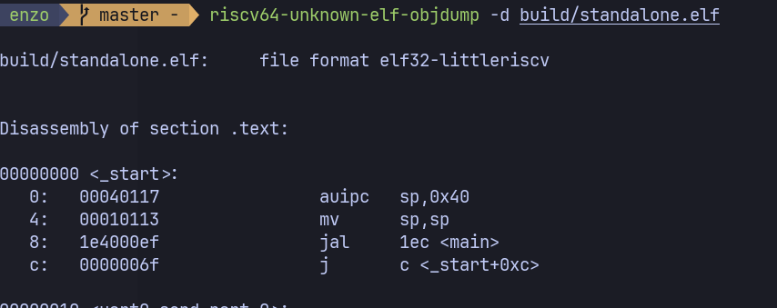

### ¿Por qué `_start` queda en `0x0`? ¿Qué pasa si se enlaza primero `print.c`?

`_start` queda en `0x0` porque el linker ubica `.text` al comienzo de FLASH y el Makefile entrega `startup.S` antes de los archivos C. `ENTRY(_start)` identifica el punto de entrada del ELF, pero por sí solo no coloca `_start` en `0x0`.

Al enlazar `print.c` primero, en la prueba `uart0_send.part.0` quedó en `0x0` y `_start` en `0x1dc`. Al salir de reset, el procesador ejecutaría la función de impresión en lugar de preparar la pila y llamar a `main()`.

### ¿Qué secciones no ubica `linker.ld` y dónde quedan `int_0`, `int_1` e `int_2`?

Con `--orphan-handling=warn`, el linker informa sobre las secciones que el script no ubica explícitamente y que él coloca por su cuenta. En la salida aparecieron `.sbss`, secciones `.debug_*`, `.riscv.attributes`, `.comment`, `.note.GNU-stack` y `.rela.text`.

La más relevante para el test es `.sbss`: allí quedaron `int_0`, `int_1` e `int_2`, en RAM. El script original incluye `.bss*`, pero ese patrón no coincide con `.sbss`. Otra sección de solo lectura que GCC puede generar para datos pequeños en RISC-V es `.srodata`.

### ¿Qué pasos faltan antes de `main()` y por qué el test termina igual?

El arranque original prepara `sp` y llama a `main`, pero no copia los valores iniciales de `.data` y `.sdata` a RAM ni pone en cero `.bss` y `.sbss`. El linker puede ubicar esas secciones, pero eso no significa que sus contenidos estén inicializados.

`test_fw_status` termina porque no comprueba que los resultados de las variables sean correctos: ejecuta sus operaciones, imprime y finalmente escribe `0xFF` en `REG_FW_STATUS`. Que termine no demuestra que el arranque haya inicializado las variables según lo que espera C.

## Hito 2 — Tabla de vectores y arranque mínimo del BL

### ¿Por qué `.vectors` se coloca primero y se usa `KEEP`? ¿Qué va en las posiciones no utilizadas?

La tabla `.vectors` se coloca primero en `BL_ROM`, que empieza en `0x0`. `KEEP` evita que el linker la descarte con `--gc-sections`. En las posiciones `0x04`, `0x08` y `0x0C`, que no son vectores en esta configuración, coloqué saltos a `bl_unexpected`: si se ejecutan por error, conducen a un manejador conocido. También se usa ese manejador para el vector de IRQ en `0x10`.

Un `ASSERT` comprueba que `_bl_vectors` coincida con el inicio de `BL_ROM` y hace fallar el enlace si la tabla queda en otra dirección.

### ¿Por qué la tabla de PicoRV32 contiene instrucciones y la de Cortex-M contiene direcciones?

En PicoRV32, el procesador ejecuta la instrucción ubicada en la dirección de reset, por eso allí hay un salto. En Cortex-M, el hardware lee los primeros valores de la tabla como datos: el valor inicial de `sp` y la dirección del manejador de reset.

### ¿Por qué el software inicializa `sp` y dónde se coloca la pila?

El software inicializa `sp` porque `STACKADDR = 0xFFFF_FFFF` indica que el core no lo hace automáticamente. `bl_reset_handler` carga `_bl_stack_top` antes de llamar a `bl_main`. Se eligió el límite superior de RAM, `0x40000`, calculado a partir de `memory_map.ld`; la pila crece hacia direcciones menores.

### ¿Por qué el BL no inicializa `.data` y `.bss`? ¿Cómo se controla?

Para este TP se eligió que el BL no use datos globales que requieran inicializar `.data` o `.bss`. Los `ASSERT` de `bl.ld` comprueban que esas secciones queden vacías después de la eliminación de secciones no usadas. El BL sí puede usar variables locales en la pila y constantes en memoria de solo lectura.

## Hito 3 — Linker del firmware

### ¿Dónde se coloca el header y por qué se usa `KEEP`?

El firmware se ubica en `APP_ROM`, desde `0x1000`. `__fw_start` marca el comienzo y `KEEP(*(.fw_header))` conserva el header, que el BL busca en esa dirección.

### ¿Qué son la LMA y la VMA de `.data`? ¿Para qué sirven sus símbolos?

La sección `.data` tiene dos direcciones:

- **LMA:** ubicación de sus valores iniciales en la imagen, dentro de `APP_ROM`.
- **VMA:** ubicación en RAM donde se utilizan las variables durante la ejecución.

El arranque copia desde `_sidata` (LMA) hasta `_sdata` en RAM, y usa `_edata` como límite. La copia inicial no mantiene las dos ubicaciones sincronizadas: si luego cambia la variable en RAM, el valor de la imagen no cambia.

### ¿Cómo se inicializa `.bss` y dónde termina la imagen?

`.bss` está en RAM y no necesita guardar sus ceros en la imagen. El arranque recorre desde `_sbss` hasta `_ebss` y escribe cero; `_ebss` es el límite exclusivo. `__fw_end` se calcula sumando la dirección de carga y el tamaño de `.data`, que es lo último cargable en este diseño. Luego, `__fw_size = __fw_end - __fw_start` da el tamaño de la imagen.

En una inspección anterior a completar el arranque, `.data` estaba vacía porque el código del test no quedaba incluido. Para observar el caso con datos, compilé una prueba conservando el código y las variables de `test_data_bss.c`. Esta prueba temporaria corresponde a una compilación distinta de la que se muestra en el hito 8.

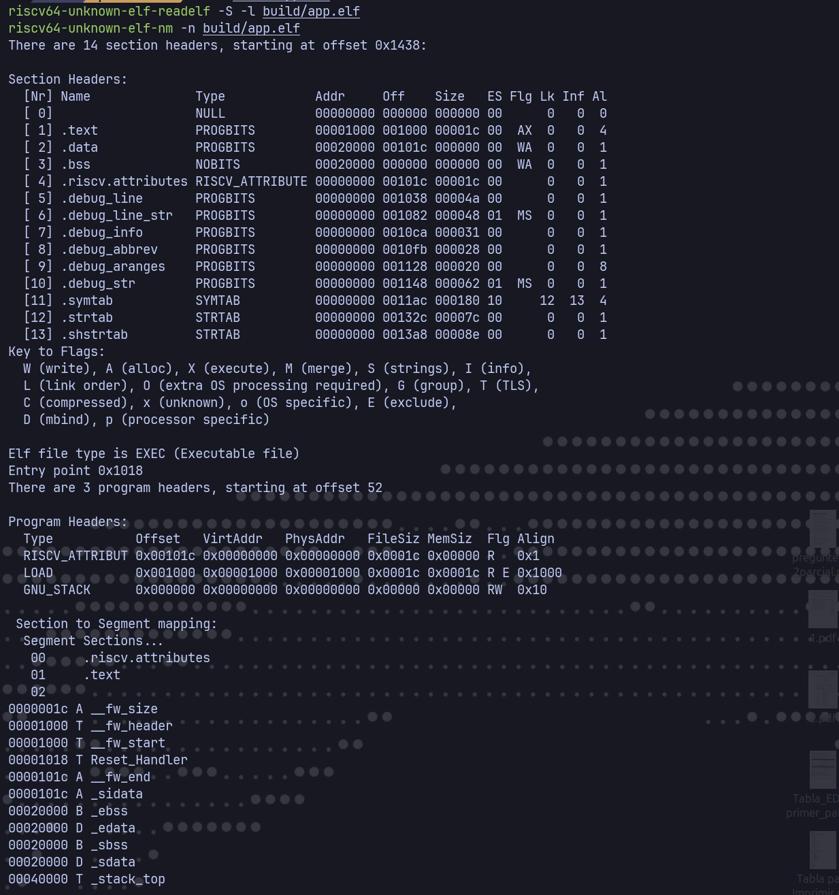

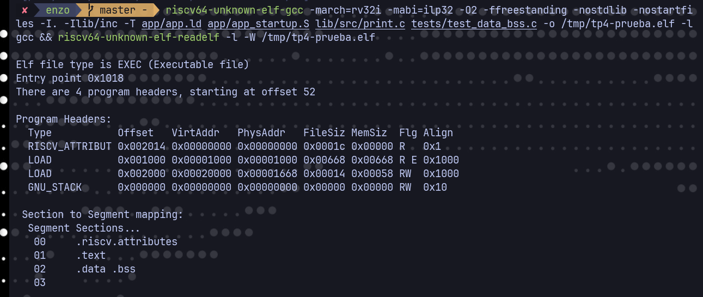

## Hito 4 — Header y arranque del firmware

### ¿Qué contiene el header y qué valor se coloca inicialmente en `image_crc`?

El header contiene **metadatos del firmware**: información que describe la imagen y le indica al bootloader cómo arrancarla. Es como una etiqueta al comienzo del firmware: indica dónde fue enlazado, cuánto ocupa, qué CRC tiene, dónde comienza su pila y a qué dirección debe saltar el BL.

Sus campos son `magic`, `load_addr`, `image_size`, `image_crc`, `initial_sp` y `reset_handler`. El linker aporta las direcciones y el tamaño; el CRC se deja inicialmente como `FW_IMAGE_CRC_UNSET` (`0xFFFFFFFF`) porque se calcula después del enlace. `mkimage.py` lo calcula sobre la imagen construida y escribe el resultado en la imagen final.

### ¿Qué hace `Reset_Handler` y por qué vuelve a cargar `sp`?

El `Reset_Handler` carga `sp`, copia `.data` y `.sdata` desde la imagen a RAM, inicializa `.bss` y `.sbss` en cero y llama a `main`. Aunque el BL ya haya cargado `sp`, el firmware vuelve a hacerlo para configurar su propia pila sin depender de cómo llegó al arranque.

### ¿Qué pasa si `main` vuelve sin indicar éxito y no se ejecuta `ebreak`?

Si `main` retorna sin dejar `REG_FW_STATUS` en `0xFF`, el arranque ejecuta `ebreak`: de otro modo la simulación podría seguir esperando sin una señal clara del error. Para detectar ese trap, en esta plataforma se conectó la señal correspondiente en el testbench.

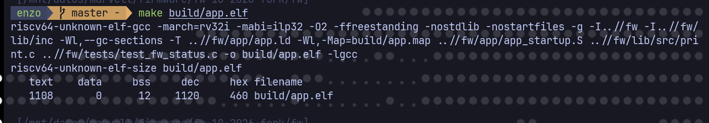

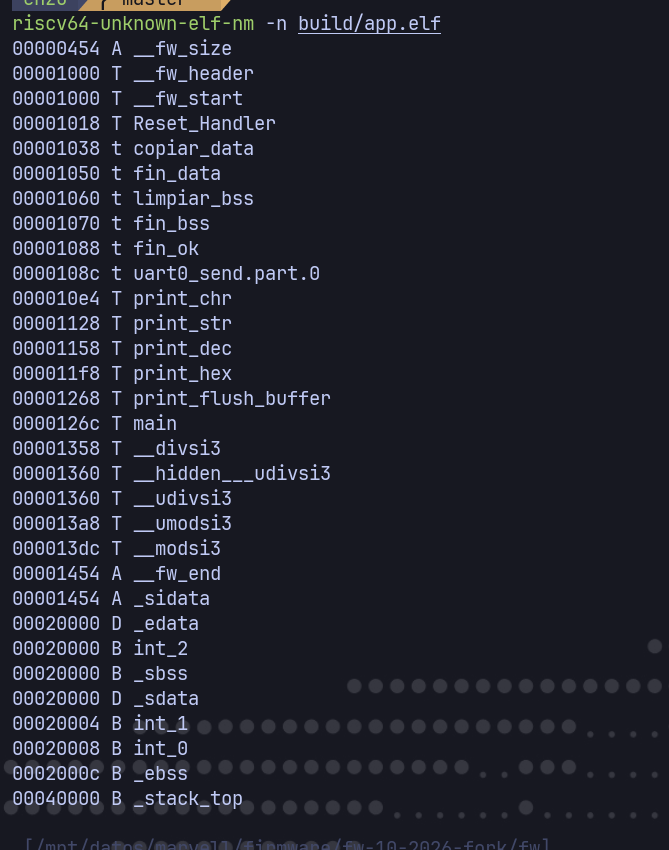

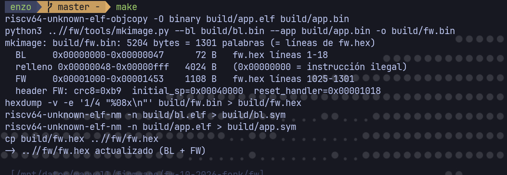

## Hito 5 — Salto del BL al firmware

### ¿Cómo lee el BL los datos del firmware y le pasa el control?

El BL informa por UART que arrancó, escribe marcas de progreso en `REG_FW_REPORT` y lee `initial_sp` y `reset_handler` del header. Después llama:

```c
bl_jump(hdr->initial_sp, hdr->reset_handler);
```

### ¿En qué registros llegan los argumentos según la ABI y cómo se realiza el salto?

Según la ABI RISC-V, el primer argumento llega en `a0` y el segundo en `a1`. La implementación ensambladora carga `sp` desde `a0` y salta a la dirección de `a1`:

```asm
mv sp, a0
la ra, bl_unexpected
jr a1
```

Se usa `jr` porque el BL entrega el control y no espera que el firmware vuelva. Se deja `bl_unexpected` en `ra` como resguardo ante un retorno inesperado usando ese valor.

El recorrido es `reset → BL → bl_main → bl_jump → Reset_Handler → main`. La simulación mostró el mensaje del BL seguido de `test_fw_status` y terminó con `REGISTER_FW_STATUS = 000000ff`.

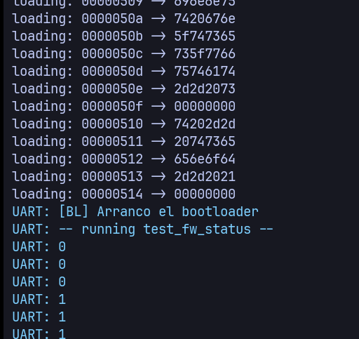

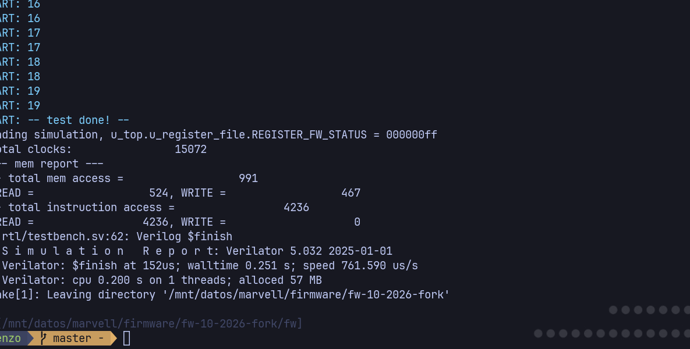

## Hito 6 — Comprobación de `.data` y `.bss`

### ¿Por qué falla el test con el arranque standalone?

Ejecuté `test_data_bss.c` con el flujo combinado y con `STANDALONE=1`:

```bash
make sim APP_SRC="print.c test_data_bss.c"
make sim APP_SRC="print.c test_data_bss.c" STANDALONE=1
```

Con el nuevo arranque el test dio **PASS**. En modo standalone dio **FAIL** porque `startup.S` no copia los valores iniciales de `.data` y `.sdata` desde la imagen a RAM: `tp4_data_word` se leyó como `0`, en lugar de `0x1234ABCD`. El arranque original tampoco inicializa `.bss` y `.sbss`; el primer error mostrado por el test fue el de `.sdata`.

La comprobación de `.data` muestra que los valores iniciales se copiaron correctamente. El resultado de `.bss` tiene un límite: la RAM del simulador ya arranca en cero, por lo que ver ceros no demuestra por sí solo que el bucle de inicialización los haya escrito.

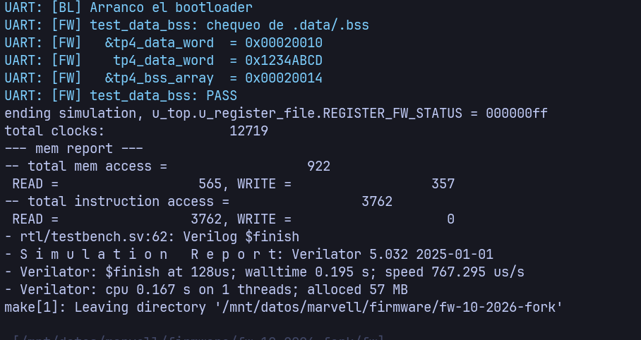

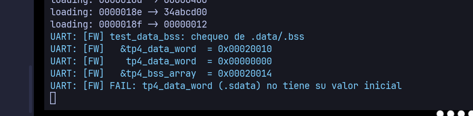

## Hito 7 — Validación de la imagen

### ¿Qué verifica el bootloader antes de saltar y por qué?

El header contiene metadatos que el BL revisa antes de ejecutar el firmware. El BL comprueba, en orden:

1. Que `magic` coincida con el identificador esperado.
2. Que `load_addr` coincida con el inicio del espacio reservado al FW.
3. Que `image_size` alcance para el header y no exceda el espacio disponible, antes de leer los bytes para el CRC.
4. Que el CRC calculado coincida con `image_crc`.
5. Que `initial_sp` esté en los límites permitidos de RAM y alineado a 16 bytes.
6. Que `reset_handler` esté dentro de la imagen y alineado a 4 bytes.

### ¿Qué hace el CRC y qué ocurre si una comprobación falla?

`str_crc8` calcula el CRC-8 desde el offset `0x10` hasta el final de la imagen, con polinomio `0x07` y valor inicial `0xFF`. El CRC ayuda a detectar corrupción; no garantiza detectar todos los errores ni identifica al autor de la imagen.

Si una comprobación falla, `bl_fail` informa el error por UART, escribe la marca y el código en `REG_FW_REPORT`, deja `0xBAD` en `REG_FW_STATUS` y llama a `bl_halt`, que ejecuta `ebreak`. Con `CORRUPT=1` se modificó un bit después de calcular el CRC; el BL informó `Error: CRC invalido` y la simulación terminó con `TRAP!`, sin saltar al firmware.

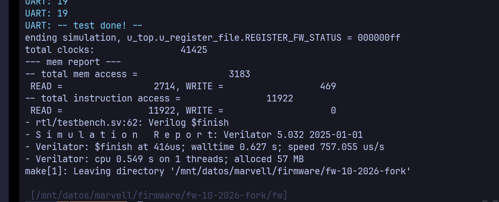

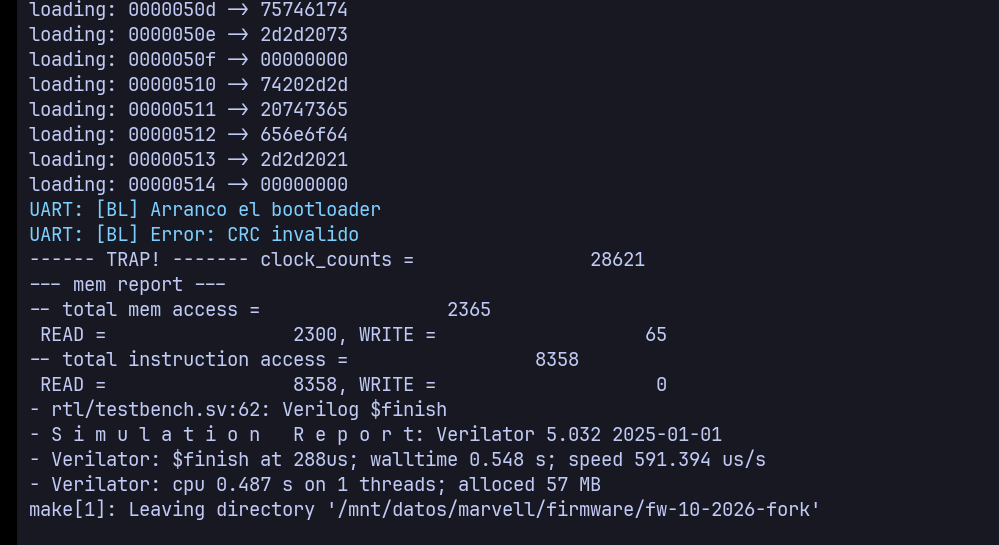

## Hito 8 — Comparación de memoria, HEX y simulación

### 1. ¿Dónde comienzan el BL y el header en el HEX y qué muestran los mapas?

Cada línea de `build/fw.hex` contiene una palabra de 4 bytes. Para una línea N, la dirección es `4 × (N − 1)`.

- Línea 1, dirección `0x0`: `0140006f`, salto inicial del bootloader.
- Línea 1025, dirección `0x1000`: `46345054`, valor `magic` del header.

Los archivos `bl.map` y `app.map` muestran la ubicación de secciones y símbolos de cada ejecutable.

### 2. ¿Qué muestran `objdump -d` y `objdump -s`?

`objdump -d build/bl.elf` muestra los saltos de la tabla del BL, incluidos los de `0x0` y `0x10`. `objdump -s -j .text build/app.elf` muestra los bytes del header. El `magic` se ve como `54 50 34 46` en memoria porque la plataforma usa *little-endian*; `fw.hex` muestra la palabra completa como `46345054`.

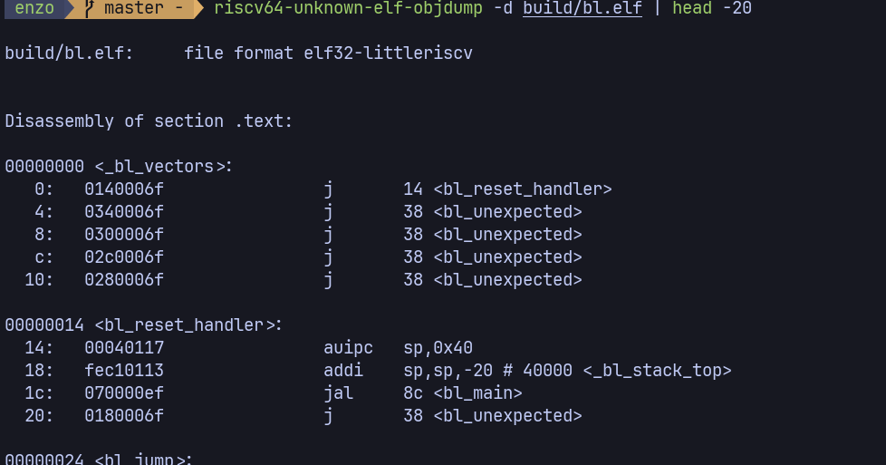

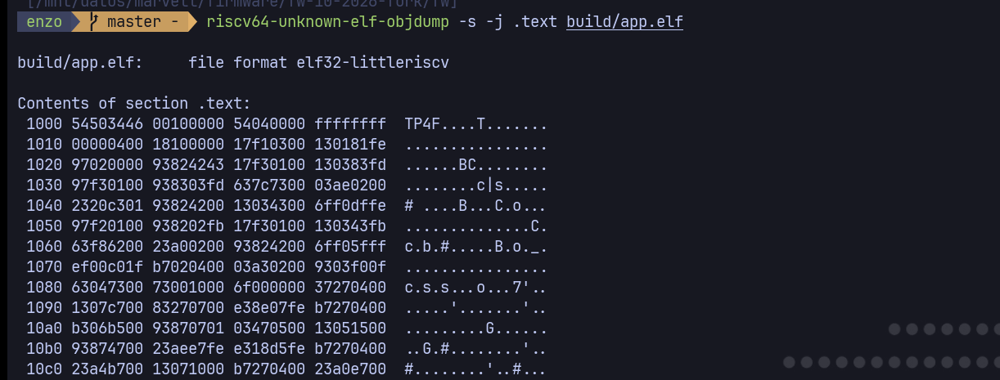

### 3. ¿Coincide la dirección del header con `nm` y el punto de entrada?

La palabra en `0x1014` —línea 1030 de `fw.hex`— contiene `0x1018`. La salida de `nm` ubica allí el símbolo `Reset_Handler`, y `readelf` indica la misma dirección como punto de entrada del ELF. Así, la dirección guardada en el header coincide con el arranque del firmware.

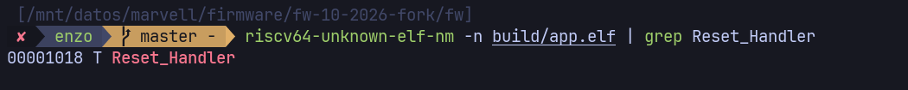

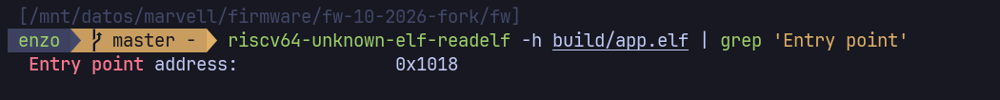

### 4. ¿Coinciden `.data` y `.bss` con el linker y el resultado del test?

En la compilación del test, `nm` mostró `_sidata = 0x16d8`, `_sdata = 0x20000`, `_edata = _sbss = 0x20014`, `_ebss = 0x20058` y `_stack_top = 0x40000`. El `readelf` permite ver la VMA en RAM y la dirección de carga de `.data` dentro de `APP_ROM`.

El test imprimió `tp4_data_word` en `0x20010`, dentro de `.data`, con el valor `0x1234ABCD`; `tp4_bss_array` comenzó en `0x20014`, dentro de `.bss`. El resultado fue **PASS**. Como se aclaró en el hito 6, el cero observado en `.bss` no prueba por sí solo que el arranque lo haya escrito, porque la RAM simulada ya comienza en cero.

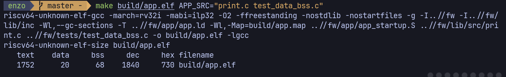

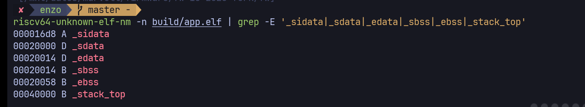

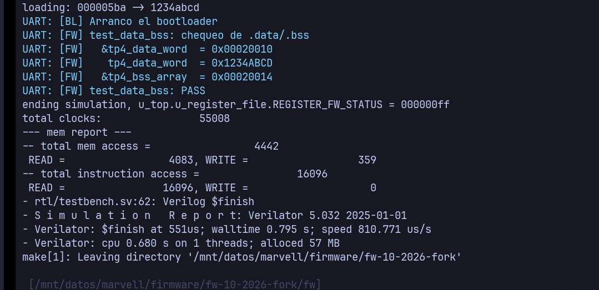

### 5. ¿Coincide el HEX con lo que cargó el simulador?

`make check` comparó `build/fw.hex` con las palabras `loading: ...` del log de simulación y mostró **RESULTADO: OK**. El índice de cada línea `loading` es un índice de palabra; para obtener la dirección en bytes se multiplica por 4.

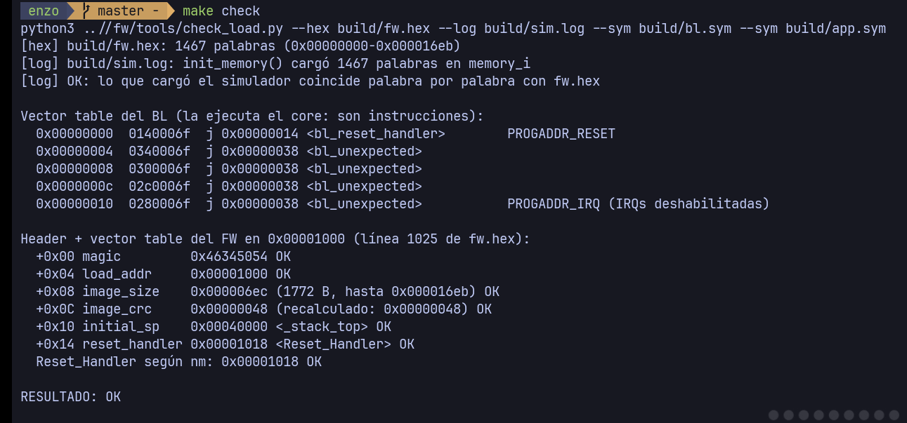

## Hito 9 — Preguntas del informe

### 1. ¿Por qué el BL usa instrucciones y Cortex-M direcciones en la tabla?

En PicoRV32 se ejecuta la instrucción que se encuentra en la dirección de reset; en Cortex-M el hardware lee de la tabla el valor inicial de `sp` y la dirección del manejador. Son comportamientos de arranque diferentes de cada arquitectura.

### 2. ¿Qué hace el Makefile?

El Makefile compila y enlaza por separado el BL y el firmware en sus respectivos ELF, genera binarios con `objcopy`, arma una imagen combinada con `mkimage.py`, la convierte a palabras hexadecimales e instala `fw/fw.hex`. También genera mapas y símbolos; `make sim` ejecuta la simulación y `make check` compara la carga.

Se enlazan `bl.elf` y `app.elf` por separado porque usan scripts y regiones diferentes: el BL comienza en `0x0` y el firmware en `0x1000`. Para `.data`, `objcopy -O binary` usa la LMA, donde están los valores iniciales en la imagen. `mkimage.py` agrega un **padding de ceros** entre el BL y el firmware para que este comience en `0x1000`; también calcula el CRC y lo escribe en el header.

### 3. ¿Por qué cambia la palabra en `0x100C`?

En `app.elf`, `image_crc` contiene el valor provisional `0xFFFFFFFF`. Después del enlace, `mkimage.py` calcula el CRC sobre la imagen y lo escribe en la imagen final; por eso la palabra en `fw.hex` es distinta.

### 4. ¿Qué instrucciones cambian al relinkear?

Las instrucciones que no dependen de direcciones pueden mantenerse iguales. Los saltos relativos también conservan su código cuando la distancia entre origen y destino no cambia; si cambia esa distancia o una dirección que debe construirse, el linker puede ajustar las instrucciones.

En la comparación de `print_str`, `lbu a5,0(a0)` fue `00054783` tanto en `0x00ac` del standalone como en `0x1128` de la app. El salto condicional `02078463` también se conservó: en ambos casos el destino estaba a `0x28` bytes. Las diferencias entre ambos ejecutables no se deben exclusivamente a la relocalización, porque el arranque nuevo también es diferente.

Como ejemplo de una dirección que cambió, en `main` el standalone carga la dirección de una cadena con `li a0,1180` (`0x49c`); en la app enlazada en `0x1000` se construye la dirección `0x1548` mediante `lui` y `addi`. Las direcciones y el código cambian porque la cadena quedó en otra posición, y la diferencia de arranque y de distribución también influye en esta comparación.

### 5. ¿Por qué `jr` y por qué volver a cargar `sp`?

`jr` transfiere el control sin crear una nueva dirección de retorno: el BL no espera que el firmware vuelva. El firmware vuelve a cargar `sp` para preparar su pila por sí mismo, aunque en el recorrido normal el BL ya haya colocado el mismo valor.

### 6. ¿Qué significan `0xFF` y `0xBAD`?

El BL no debe escribir `0xFF`: ese valor le indica al simulador que el firmware terminó correctamente y podría hacer que la simulación finalice antes del salto. En caso de error, `0xBAD` deja una marca, pero no es la condición de éxito ni detiene por sí solo la simulación. Por eso el BL ejecuta `ebreak` para provocar un trap; la simulación debe observar esa señal.

### 7. ¿Qué funciones de `strutils.c` quedan en el BL?

En `bl.elf` queda `str_crc8`, porque el bootloader la utiliza para validar la imagen. Las demás funciones no utilizadas se descartan con `--gc-sections` y la compilación por función. El CRC no necesita llamadas a la biblioteca estándar.

### 8. ¿Qué ocurre sin `.option norvc`?

Si se compila con instrucciones comprimidas, algunos saltos podrían ocupar 2 bytes en lugar de 4. Como la tabla usa saltos consecutivos, las posiciones cambiarían y el vector de IRQ podría no quedar en `0x10`. `.option norvc` mantiene instrucciones de 4 bytes en esa tabla.

## Aclaración sobre el testbench

La consigna indica no modificar el RTL ni la configuración de la plataforma. Sin embargo, durante la prueba con `CORRUPT=1`, la simulación quedaba ejecutándose porque la señal `trap` del testbench original no estaba conectada a la salida del procesador. Para poder observar el error y finalizar la prueba, se conectó esa señal en `rtl/testbench.sv` a `u_top.trap`.

Con esa modificación, la prueba mostró el mensaje de CRC inválido y terminó con `TRAP!`. El cambio se deja aclarado porque afecta a un archivo del testbench fuera de `fw/` y se aparta de la restricción indicada en la consigna.
