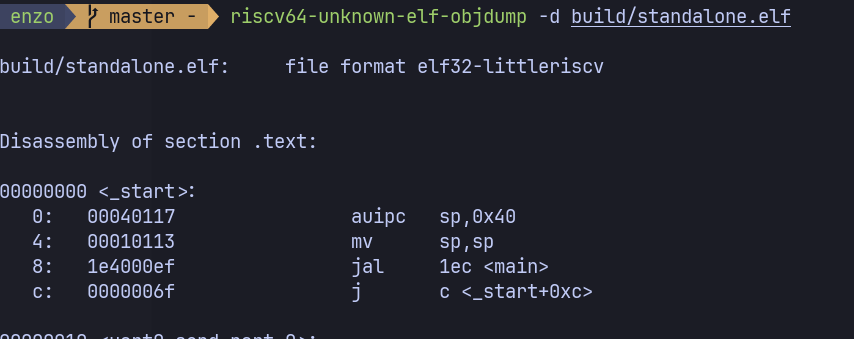

# hito 1



1. auipc suma al PC de esa instrucción el valor inmediato desplazado 12 bits. En este caso:
   
   sp = 0x00000000 + (0x40 << 12) = 0x00040000
   
   Ese valor es _stack_top, definido en linker.ld (fw/linker.ld). Las dos primeras instrucciones provienen de la sp, _stack_top en startup.S (fw/startup.S). mv sp,sp es la forma que muestra objdump para un addi sp,sp,0: en este caso no modifica el resultado.
   
   _start queda en 0x0 porque el linker ubica .text al principio de FLASH, cuya dirección inicial es 0x0, y el Makefile pasa startup.S antes que los archivos C. La directiva ENTRY(_start) marca el punto de entrada del ELF, pero por sí sola no coloca _start en 0x0.
   
   Al probar con print.c antes de startup.S, quedó uart0_send.part.0 en 0x0 y _start en 0x1dc. Así que sí: tras el reset, el procesador empezaría a ejecutar el código de esa función, sin haber preparado el stack ni sus argumentos. No saltaría automáticamente a _start, aunque este figure como entrada del ELF.

2. Secciones huérfanas
   
   Con --orphan-handling=warn, el linker informa que ubica por su cuenta .sbss, secciones de depuración .debug_*, .riscv.attributes, .comment, .note.GNU-stack y una sección de relocaciones .rela.text.
   
   La relevante para las variables del test es .sbss: allí quedan int_0, int_1 e int_2, en RAM. El script contempla .bss*, pero eso no incluye .sbss. Se puede comprobar con:
   
   riscv64-unknown-elf-readelf -S -W fw/build/standalone.elf
   riscv64-unknown-elf-nm -n -S fw/build/standalone.elf

3. Pasos que faltan antes de main()
   
   El startup actual carga sp y llama a main, pero no copia los valores iniciales de .data desde la imagen a RAM ni pone en cero .bss y .sbss. Tampoco prepara otros elementos que podrían necesitarse según la plataforma, como inicialización de hardware o constructores de C++.
   
   El test termina porque no verifica los valores finales de esas tres variables: hace operaciones, imprime y finalmente escribe 0xFF en REG_FW_STATUS. Además, las variables no tienen valores iniciales distintos de cero que haya que copiar desde .data. Que este test termine no demuestra que el arranque cumpla la inicialización de variables globales que espera C.
   
   /* TODO: ¿que otra seccion de solo lectura genera GCC en RISC-V? (hito 1) */
   
   La sección que falta es **`.srodata`**: contiene datos pequeños de solo lectura que GCC puede generar para RISC-V.

# Hito 2 — Arranque del bootloader

1. **¿Qué se pone en las posiciones 0x04, 0x08 y 0x0C, que no son vectores de PicoRV32?**
   
   Decidí poner saltos a `bl_unexpected`. Así, si el procesador llega a ejecutar alguna de esas posiciones por error, irá a un manejador conocido. Las tres posiciones pueden compartirlo con el vector de IRQ de `0x10`, aunque el manejador no distingue por sí solo desde cuál se llegó. Con `.option norvc` cada salto ocupa 4 bytes, por lo que el quinto queda en `0x10`.

2. **¿Por qué la tabla del BL contiene instrucciones y la de Cortex-M contiene direcciones?**
   
   Son comportamientos del hardware. En esta configuración PicoRV32 empieza a ejecutar la instrucción ubicada en `0x0`, por eso allí ponemos un salto. En Cortex-M el procesador lee de la tabla el valor inicial de la pila y la dirección del manejador de reset. La diferencia no es si el código está compilado: en ambos casos debe estarlo.

3. **¿Por qué el software debe inicializar `sp`?**
   
   En esta plataforma `STACKADDR = 0xFFFF_FFFF` indica que el core no inicializa `sp` al salir de reset. Por eso `bl_reset_handler` carga la dirección `_bl_stack_top` antes de llamar a `bl_main`, ya que el código C puede necesitar la pila. `la sp, _bl_stack_top` carga la dirección, no el contenido de memoria que hay allí.

4. **¿Por qué el BL no copia `.data` ni pone `.bss` en cero? ¿Cómo se controla?**
   
   El arranque mínimo del BL supone que no hay variables que requieran esas inicializaciones. En `bl.ld` se agrupan `.data` y `.sdata`, por un lado, y `.bss`, `.sbss` y `COMMON`, por otro; los `ASSERT` comprueban que ambas secciones tengan tamaño cero. Con `--gc-sections`, esto detecta las secciones que quedan después de descartar las no usadas; para conservarlas también durante esa comprobación puede usarse `KEEP`. Una constante puede ir en `.rodata` sin requerir inicialización en RAM.

5. **¿Por qué `.vectors` va primero y se usa `KEEP`?**
   
   La tabla debe empezar en `0x0`, donde el core ejecuta la primera instrucción tras reset. `KEEP(*(.vectors))` la ubica antes del resto del código en `.text` y evita que `--gc-sections` la descarte. `bl.ld` ubica `.text` en `BL_ROM`, cuyo origen es `0x0`. Queda pendiente agregar el `ASSERT` que compruebe explícitamente la dirección de la tabla.

6. **¿Dónde conviene poner `_bl_stack_top`?**
   
   En el extremo superior de RAM: `ORIGIN(RAM) + LENGTH(RAM)`, que en este mapa da `0x40000`. La pila RISC-V crece hacia direcciones menores, dentro de RAM. También podría usarse otra dirección de RAM o una región reservada, cuidando el espacio disponible y posibles superposiciones. El símbolo se puede definir fuera de `SECTIONS`: representa una dirección y no reserva por sí solo espacio para la pila.

# Hitor 3

¿Por que KEEP? se usa keep porque evita que el compliador no lo optimize si ve que "no se usa "

(¿donde termina la copia de .data?)**la copia inicial de `.data` termina en APP_ROM donde empieza esa copia más el tamaño de `.data`**. Esa dirección es `__fw_end`, porque en este diseño `.data` es lo último que se guarda en la imagen cargable.

me olvide de hacer el make y no pued ver el iltimo reustlado 


no se puede ver vitau addr porqeu no tenia nunguna vraible inciazliado 

arme un comandito El primer comando compila el arranque y el test usando tu `app.ld`, y crea un ejecutable de prueba conservando sus datos. El segundo lee ese ejecutable y muestra dónde quedaron ubicados el código y las variables en memoria. 


# hito 4

) sp = _stack_top. ¿Hace falta si el BL ya lo cargó desde la vector table?

Si el bootloader ya cargó sp con el valor indicado en la tabla de vectores, no es estrictamente necesario volver a cargarlo en el recorrido normal. Sin embargo, el firmware lo hace para asegurarse de configurar su propia pila y no depender de cómo se llegó a Reset_Handler.

      (¿qué pasa con la simulación si no lo hacen?) 

si no lo tiene la simualcion seguirai y soabrais que tendrias u nerror 


# hito 5  ccosto

Porque está definido en la **convención de llamadas de la ABI de RISC-V**. La documentación indica que los registros `a0` a `a7` se usan para pasar argumentos enteros a las funciones. [Documentación oficial de RISC-V](https://docs.riscv.org/reference/abi/v1.0/riscv-cc-procedure-calling-convention.html).

**1. ¿En qué registros llegan `sp` y `entry`?**

Según la ABI de RISC-V, los primeros argumentos llegan en `a0`, `a1`, etc. Entonces:

- `a0` contiene `initial_sp`: la dirección inicial de la pila.
- `a1` contiene `reset_handler`: la dirección a la que tiene que saltar.

Sobre la pregunta del comentario:

- **`jr a1`** salta a la dirección del firmware sin guardar una nueva dirección de retorno. Conviene porque el BL le entrega el control al firmware y no espera recuperarlo.
- **`jalr ra, ...`** guardaría una dirección de retorno en `ra`, como si fuera una llamada que esperamos que vuelva.


El **hito 5** busca que el bootloader le entregue el control al firmware. El procesador arranca en `0x0`, ejecuta el BL y, después, el BL debe encontrar dónde empieza el firmware y saltar a su código de arranque.

El firmware tiene un **header** al comienzo de `APP_ROM`. Dos de sus campos son necesarios para el salto:

- `initial_sp`: dirección inicial de la pila del firmware.
- `reset_handler`: dirección de su código de arranque.

En `bl_main.c`, el puntero `hdr` apunta a ese header. El BL informa por UART que arrancó, deja marcas de progreso en `REG_FW_REPORT` y llama a la función de salto con los dos valores:

```
bl_jump(hdr->initial_sp, hdr->reset_handler);
```

`bl_jump` está escrita en `bl_start.S`. Como se llama desde C, ambas partes siguen la **ABI de RISC-V**: el primer argumento llega en `a0` y el segundo en `a1`. La función carga `sp` con el primer valor y salta a la dirección del segundo:

```
mv sp, a0
la ra, bl_unexpected
jr a1
```

Se usa `jr` porque el BL le entrega el control al firmware y no espera que vuelva. En `ra` se deja `bl_unexpected` como destino ante un retorno inesperado.

El recorrido completo queda:

```
Reset → bootloader → bl_main → bl_jump
                                  ↓
               Reset_Handler del firmware → main
```

Lo comprobaste con `make sim`: apareció el mensaje del BL, después se ejecutó `test_fw_status` y la simulación terminó con `REGISTER_FW_STATUS = 000000ff`. Las validaciones de la imagen quedan para el hito 7.

# hito 6

make sim APP_SRC="print.c test_data_bss.c"      


make sim APP_SRC="print.c test_data_bss.c" STANDALONE=1 , STANDALONE =1 CONSTRUYE EL FIRMWARE SIN BOOTLOADER 

Reset → startup.S → main del firmware

con bootlader

Reset → bootloader → arranque del firmware → main


El test falla en modo standalone porque el arranque original no copia los valores iniciales de .data y .sdata desde la imagen del firmware a RAM antes de llamar a main. En esta simulación, tp4_data_word contiene 0 en lugar del valor inicial esperado, por lo que el test informa FAIL.

En el flujo con bootloader, el nuevo Reset_Handler del firmware realiza esa copia y también inicializa .bss y .sbss en cero.

# hito 7

El **header** es un pequeño encabezado al principio de la imagen del firmware. Contiene datos que el bootloader necesita leer **antes de ejecutar el firmware**.

Pensalo como la etiqueta de un paquete: antes de abrirlo, te dice qué contiene y cómo tratarlo. En este TP, la imagen se organiza así:

```
0x1000 ┌───────────────────────────┐
       │ Header                    │
       │  magic                    │
       │  load_addr                │
       │  image_size               │
       │  image_crc                │
       │  initial_sp               │
       │  reset_handler            │
       ├───────────────────────────┤
       │ Código y datos del FW     │
       │ ...                       │
       └───────────────────────────┘
```

Cada campo responde una pregunta:

- **`magic`**: ¿parece ser una imagen del formato que espera el BL?
- **`load_addr`**: ¿para qué dirección fue preparado el firmware?
- **`image_size`**: ¿cuántos bytes ocupa la imagen?
- **`image_crc`**: ¿coincide el contenido con el CRC calculado al construirla?
- **`initial_sp`**: ¿qué valor debe tener la pila al arrancar?
- **`reset_handler`**: ¿a qué dirección debe saltar el BL para iniciar el firmware?

Es importante porque el bootloader necesita esa información para decidir **si puede entregar el control y dónde hacerlo**. Por ejemplo, si la dirección de `reset_handler` estuviera fuera de la imagen, saltar allí podría ejecutar algo inesperado.

En tu código, `hdr` es el puntero que le permite al BL leer esos campos. Las verificaciones del hito 7 los revisan antes de llamar a `bl_jump`. El header no es una garantía por sí solo: el BL tiene que comprobar sus valores, y el CRC ayuda a detectar corrupción, no demuestra quién creó la imagen.

make sim


tuve probela que se qeudaba trabado la simulacion con el error pero erap orque esta cvoendo el cable de trap


# hito 8

### 1

linea 1: 0140006f

linea 1025: 46345054 (valor magic)

### 2


```
1000  54503446 ...
```

Esos son los bytes del `magic`. En `fw.hex` lo ves como `46345054` porque allí se muestra la palabra de 32 bits; `objdump -s` muestra sus bytes en orden de memoria, que en RISC-V es *little-endian*.

### 3

 lienea 1030:00001018


fw.hex, dirección 0x1014 → guarda 0x1018
nm, Reset_Handler        → está en 0x1018
readelf, Entry point     → indica 0x1018

### 4


### 5


